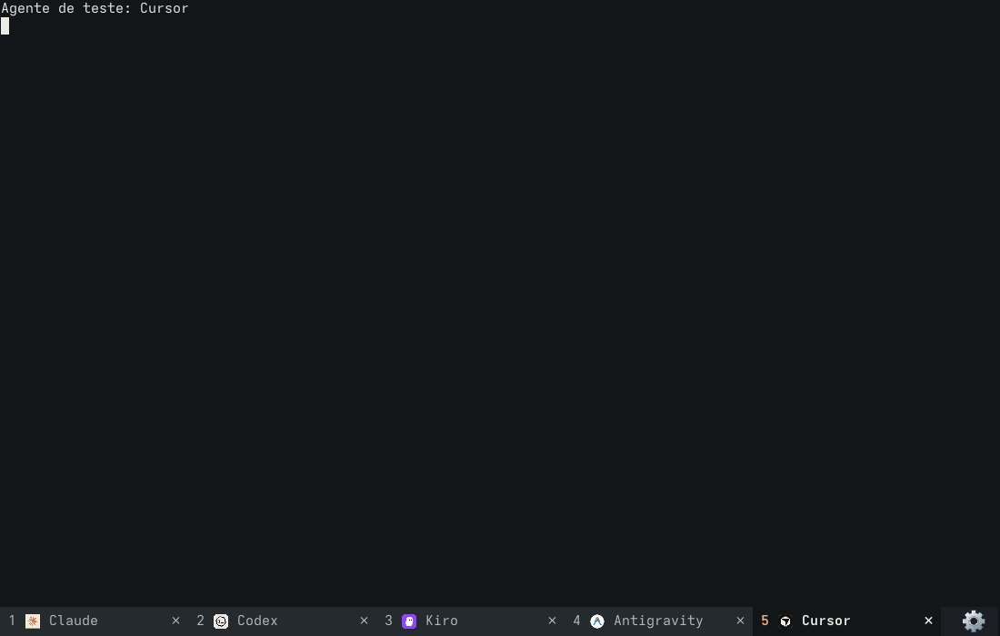

<div align="center">


Terminal Linux nativo, em Rust. A tela sai por Vulkan e as abas ficam no rodapé.


</div>

## Uso

Abre um shell em cada aba. O diretório inicial fica em `~/.config/rustty/ui.conf`, na chave `cwd`.

```bash
rustty
```

A engrenagem no canto da faixa, ou `Ctrl+,`, abre fonte, tamanho e tema. A escolha fica no mesmo arquivo.

<div align="center">



</div>

Enquanto Claude, Codex, Kiro, Antigravity ou Cursor estão em primeiro plano, a aba mostra o ícone correspondente. No resto do tempo, mostra o do Rustty.

## Atalhos

| Atalho | Efeito |
| --- | --- |
| `Ctrl+Shift+T` | abre uma aba |
| `Ctrl+Shift+W` ou `Ctrl+Shift+Q` | fecha a aba |
| `Ctrl+Shift+←` / `→` | aba anterior / próxima |
| `Ctrl+PageUp` / `PageDown` | aba anterior / próxima |
| `Ctrl+Shift+1` … `9` | vai para a aba |
| `Shift+PageUp` / `PageDown` | rola o scrollback |
| `Ctrl+,` | aparência |

O que não está nessa lista segue para o shell. `TERM` é `xterm-256color`.

## Instalação

Precisa de Rust, `pkg-config`, Vulkan e FreeType.

```bash
git clone https://github.com/gutopardini/rustty && cd rustty
cargo build --release --bin rustty
install -Dm755 target/release/rustty "$HOME/.local/bin/rustty"
install -Dm644 assets/brand/rustty-icon.svg "$HOME/.local/share/icons/hicolor/scalable/apps/rustty.svg"
install -Dm644 packaging/linux/rustty.desktop "$HOME/.local/share/applications/rustty.desktop"
```

`~/.local/bin` precisa estar no `PATH` da sessão gráfica.

`rustty-probe` mostra a GPU e, se existir, a NPU Intel. `rustty-bench` mede o parser.

## Licença

MIT.
