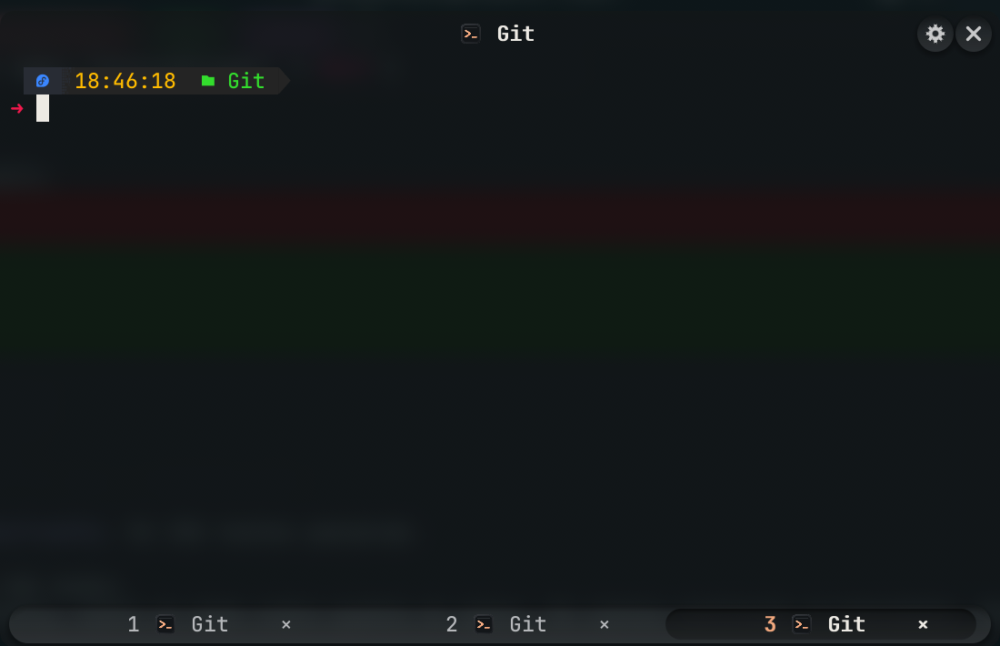
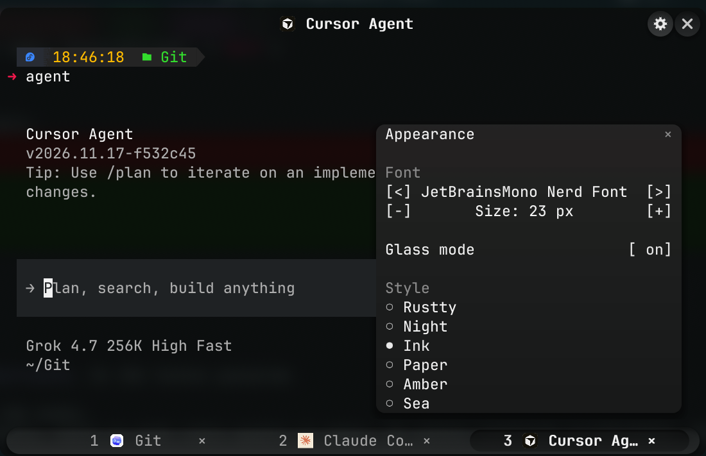
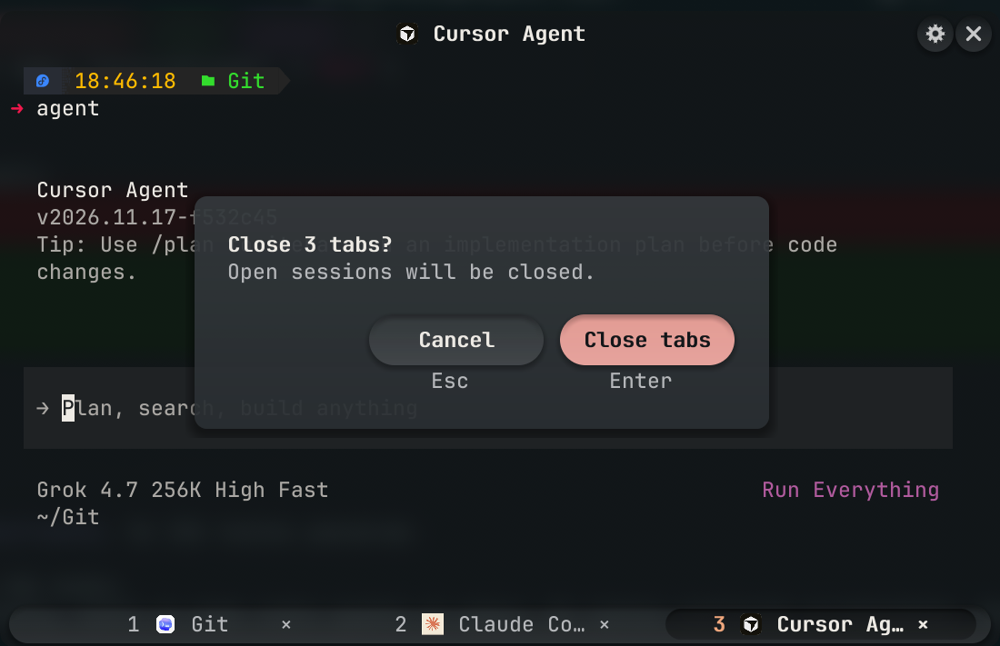

<div align="center">


A performance-focused CLI for LLMs. Written in Rust, drawn on the GPU, with the NPU on the roadmap.



</div>

Rustty is a native Linux terminal for the model CLIs that stay open all day: Claude, Codex, Kiro, Antigravity, and Cursor. The cell grid is rendered with Vulkan. Glyphs live in VRAM, the parser stays off the present path, and only the rows that changed are uploaded. Scrollback is already staged in an Intel NPU buffer. The next step is to run search on that processor once a compiled command graph is in place.

## Run

Each tab is its own shell. The starting directory is `cwd` in `~/.config/rustty/ui.conf`.

```bash
rustty
```

The gear at the end of the tab strip, or `Ctrl+,`, opens font, size, and theme. The choice is stored in the same file.

<div align="center">



</div>

The same panel turns on **Glass mode**. The window becomes translucent and the desktop behind it is blurred by the compositor through `ext-background-effect-v1`, which GNOME 51 and Plasma 6.7 offer. The tabs sit in a glass capsule, the active one in a pill, and the gear and window buttons become round glass. The shapes are drawn in a shader. Text and explicit colors stay opaque. `glass_opacity=0.78` in `ui.conf` sets the tint. With Glass mode off, the window is opaque.

`TERM` is `xterm-256color`. `TERM_PROGRAM` is `rustty-kitty`, so Codex can see that Kitty graphics are available and draw `/pets` in the session.

## The screen

The window is a grid of cells, not a texture of the whole frame. A dirty row is the unit of upload. Box drawing and Nerd Font symbols are rasterized to meet the cell edge, so prompts stay aligned. Images from the Kitty graphics protocol, including Codex pets, are composited on the GPU with the alpha of the PNG.

<div align="center">


</div>

While Claude, Codex, Kiro, Antigravity, or Cursor is in the foreground, the tab shows that icon. Otherwise it shows Rustty. The title bar mirrors the active tab's icon and title.

## The NPU

`rustty-probe` reports the Vulkan device and, when present, the Intel NPU. Lines that leave the screen are hashed and written into a buffer mapped on that processor. The firmware does not run a graph until a compiled `RTY1` command buffer is submitted. That graph is the planned path for scrollback search. Until then, the index stays on the CPU and the screen stays on the GPU.

`rustty-bench` measures the parser.

## Keys

| Shortcut | Action |
| --- | --- |
| `Ctrl+Shift+T` | open a tab |
| `Ctrl+Shift+W` or `Ctrl+Shift+Q` | close the tab |
| `Ctrl+Shift+←` / `→` | previous / next tab |
| `Ctrl+PageUp` / `PageDown` | previous / next tab |
| `Ctrl+Shift+1` … `9` | jump to a tab |
| `Shift+PageUp` / `PageDown` | scroll the scrollback |
| drag | select text; the selection is copied when the button is released |
| double-click / triple-click | select a word / the line |
| `Ctrl+Shift+C` | copy the selection |
| `Ctrl+Shift+V` | paste |
| middle-click | paste the primary selection |
| `Ctrl+,` | appearance |

The close button on the title bar asks before it closes the window when more than one tab is open. One tab closes immediately.

<div align="center">



</div>

Anything else goes to the shell.

A click on an `http://` or `https://` address opens it in the browser. A click on a file path opens that file in the default application for its type. A trailing `:line` or `:line:column` is ignored, and a relative path is resolved from the shell's directory. An application that is already open receives the target. A new window appears only when none is open.

## Install

You need Rust, `pkg-config`, Vulkan, and FreeType.

```bash
git clone https://github.com/gutopardini/rustty && cd rustty
cargo build --release --bin rustty
install -Dm755 target/release/rustty "$HOME/.local/bin/rustty"
install -Dm644 assets/brand/rustty-icon.svg "$HOME/.local/share/icons/hicolor/scalable/apps/rustty.svg"
install -Dm644 packaging/linux/rustty.desktop "$HOME/.local/share/applications/rustty.desktop"
```

`~/.local/bin` needs to be on the `PATH` of the graphical session.

## License

MIT.
